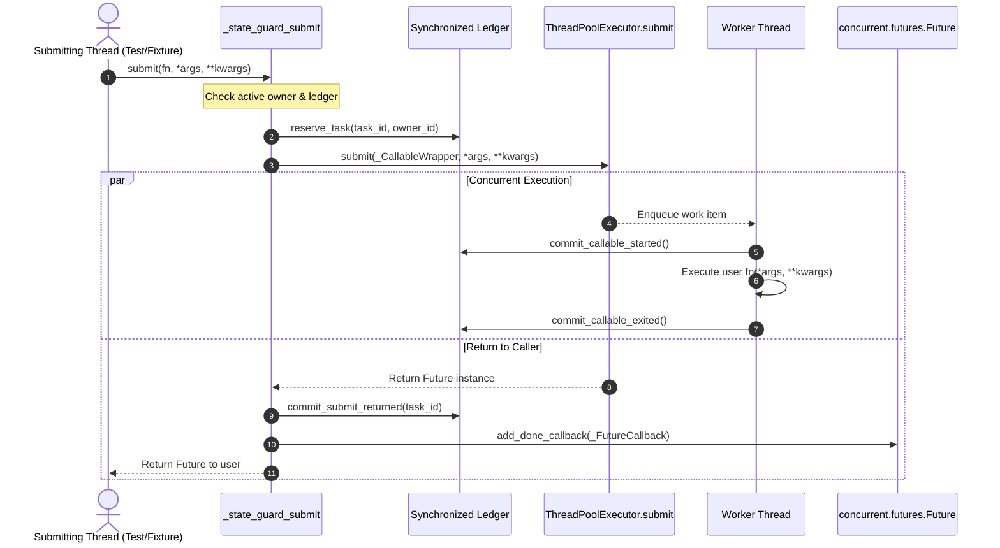

# Concurrency & Interception Model

This document provides a technical analysis of `pytest-state-guard`'s concurrency architecture, submission interception mechanics, serialized event ledger, and timing semantics.

---

## Submission Interception Architecture

State Guard intercepts task submission by dynamically patching `concurrent.futures.ThreadPoolExecutor.submit` during the pytest session. The patching is thread-safe and idempotent under an internal mutex (`_PATCH_LOCK`).



### The Five Interception Steps
In [src/pytest_state_guard/executor.py](file:///C:/Users/Rud/Desktop/state-guard/src/pytest_state_guard/executor.py):
1. **Context Verification:** State Guard queries `get_current_owner()` and `_ACTIVE_LEDGER`. If unowned or inactive, it delegates immediately to the original uninstrumented `submit` with zero overhead.
2. **Pre-Submission Reservation:** Generates a collision-resistant UUID (`task:<hex>`) and commits `TASK_RESERVED` under the ledger lock.
3. **Callable Wrapping:** Wraps the user callable in `_CallableWrapper`, capturing the active `OwnerContext` and `task_id`.
4. **Original Invocation:** Calls the real `ThreadPoolExecutor.submit(self, wrapped_fn, *args, **kwargs)`. If `submit()` raises, it records `SUBMIT_RAISED` and re-raises the original exception unchanged.
5. **Done Callback Attachment:** Upon return, records `SUBMIT_RETURNED` and attaches `_FutureCallback` to observe Future settlement.

---

## Callable Execution vs. Future Settlement

State Guard explicitly separates **callable lifecycle** from **Future lifecycle**:

| Lifecycle Dimension | Monitored Entity | Event Trigger |
| :--- | :--- | :--- |
| **Callable Lifecycle** | `_CallableWrapper` | Committed when the worker thread begins user code (`CALLABLE_STARTED`) and when user code exits by return or exception (`CALLABLE_EXITED`). |
| **Future Lifecycle** | `_FutureCallback` | Committed when `future.add_done_callback()` invokes the listener upon settlement (`FUTURE_DONE_CALLBACK_OBSERVED`). |

### Callback Execution Semantics
Standard Python `concurrent.futures.Future.add_done_callback(fn)` follows strict threading rules:
- **Immediate Execution:** If the Future is already complete when the callback is attached, the callback executes **immediately within the registering thread**.
- **Deferred Execution:** If the Future is pending, the callback executes in the **completing thread** (the thread that invokes `set_result()`, `set_exception()`, or `cancel()`). While typically an executor worker thread, any thread resolving the Future becomes the completing thread.
- **Settlement Observation:** State Guard's `FUTURE_DONE_CALLBACK_OBSERVED` event is a *committed observation of settlement*, not the exact microsecond of physical completion.

### Out-of-Order Execution Realities
Because worker threads run concurrently with the submitting thread:
- A worker thread can start and complete before `ThreadPoolExecutor.submit()` returns to the caller.
- Therefore, $S_{\text{start}}$ and $S_{\text{exit}}$ can legitimately commit *before* $S_{\text{ret}}$ in the ledger sequence. State Guard's policy engine handles this naturally without flagging spurious violations.

---

## Fail-Open Instrumentation Boundaries

State Guard isolates its instrumentation to ensure that ledger failures never crash user test execution or mask application exceptions:

1. **Reservation Failure:** In `_state_guard_submit`, if `reserve_task()` raises `Exception`, submission falls back to the original uninstrumented `submit()`.
2. **Callable Start & Exit:** In `_CallableWrapper.__call__`, `commit_callable_started()` is wrapped in `try...except Exception: pass` so user code always runs. In the `finally:` block, `commit_callable_exited()` catches and suppresses `Exception` to avoid masking user exceptions or return values.
3. **Future Callback:** In `_FutureCallback.__call__`, exceptions during `commit_future_done()` are caught and suppressed to prevent breaking executor callback chains.

> **Audit Completeness Caveat:** Suppressing an instrumentation exception drops ledger evidence. State Guard does **not** guarantee diagnostic completeness after a silent commit failure; it prioritizes non-interference with user test business logic over diagnostic completeness.

---

## The Serialized Event Ledger & Timing Semantics

In [src/pytest_state_guard/ledger.py](file:///C:/Users/Rud/Desktop/state-guard/src/pytest_state_guard/ledger.py), all lifecycle transitions are serialized under a single non-reentrant mutex (`threading.Lock`):

```python
def _commit_event_locked(self, event_type: EventType, ...) -> EventRecord:
    ts_ns = time.monotonic_ns()
    seq_id = next(self._seq_counter)
    # Event construction and log append under lock
```

### Authoritative Sequence (`seq_id`) vs. Timestamps (`ts_ns`)
- **Authoritative Sequence:** `seq_id` is a strictly incrementing, gapless monotonic integer. State Guard's formal policy engine evaluates boundaries **strictly against sequence ordering ($S_*$)**, not physical timestamps.
- **Physical Timestamps:** `time.monotonic_ns()` is captured when an event commits under the lock. Contention or thread preemption means that physical operations happen before lock acquisition. Differences between physical event occurrence and ledger timestamps reflect **lock acquisition serialization delay, not clock skew**.

---

## Snapshot Consistency and Immutability

When evaluating an owner boundary, State Guard captures all evidence under a single lock acquisition:

```python
def get_owner_snapshot(self, owner_id: str) -> tuple[OwnerRecord, list[TaskRecord], list[EventRecord]]:
    with self._lock:
        return self._owners[owner_id], list(tasks), list(events)
```

### Snapshot Guarantees
1. **Deep Immutability:** Domain records (`OwnerRecord`, `TaskRecord`, `EventRecord`) are `@dataclass(frozen=True)`. Event `details` mappings are recursively frozen into immutable `MappingProxyType`, `tuple`, and `frozenset`.
2. **Replacement Semantics:** State transitions in the ledger create new record instances using `dataclasses.replace` and update internal dictionary references; existing record instances are never mutated in place.
3. **Point-in-Time Consistency:** The snapshot captures a coherent, atomic point-in-time view of the owner and its tasks at that exact sequence point.

---

## Architectural Limitation: `reserve_task()` Atomicity

State Guard documents the following structural limitation in `Ledger.reserve_task()`:

```python
with self._lock:
    # 1. Pre-commit validations (EntityNotFoundError / DuplicateEntityError)
    # 2. Append EventRecord(TASK_RESERVED) to self._events
    # 3. Insert TaskRecord into self._tasks[task_id]
```

`reserve_task()` does **not** implement a transactional rollback or compensating undo between steps 2 and 3. 

While normal failures are pre-commit validation errors that leave the ledger untouched, an unexpected runtime exception (such as a catastrophic `MemoryError`) occurring after step 2 would leave an orphaned `TASK_RESERVED` event in `_events` without a corresponding entry in `_tasks`. State Guard does not claim universal database-style transactionality.

---

## Related Documentation

- [Ownership & Lifecycle Architecture](ownership-and-lifecycle.md): Details on submitter context and ContextVar binding.
- [Reporting & Pytest Integration](reporting.md): How findings are evaluated and injected into pytest terminal reports.
