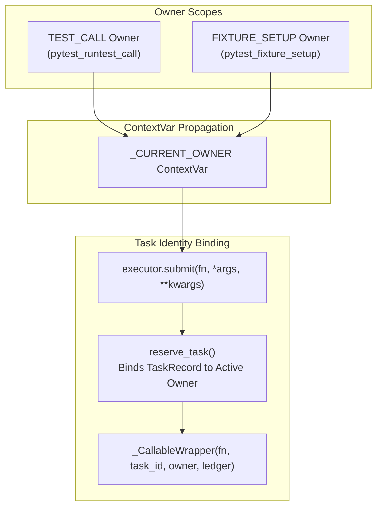
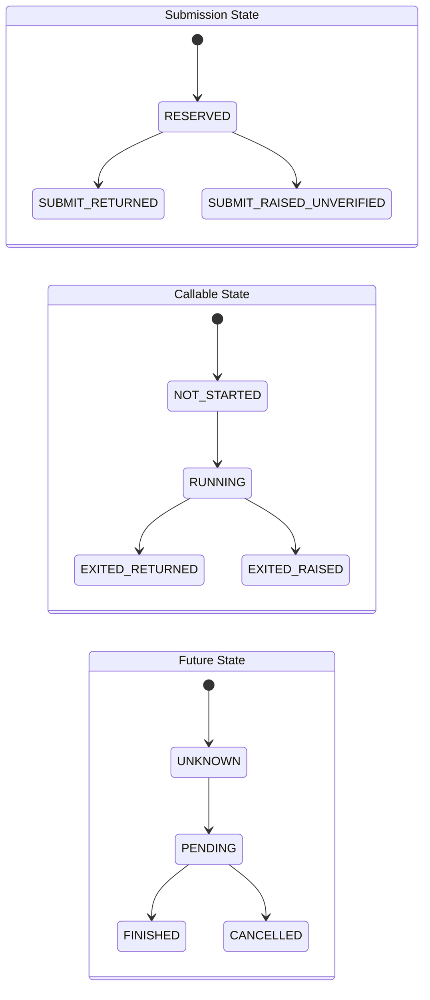

# Ownership & Lifecycle Architecture

This document describes how `pytest-state-guard` models task provenance, binds execution contexts across thread boundaries, and audits task lifecycles against pytest owner scopes.

---

## The Submitter Ownership Model

In concurrent Python testing, an executor (`concurrent.futures.ThreadPoolExecutor`) is merely an execution resource. It is frequently configured as a shared, long-lived object spanning multiple test cases or fixtures. 

The entity accountable for task creation, execution duration, and resource cleanup is the **submitter**. State Guard attaches task ownership to the active pytest lifecycle scope in which `executor.submit()` is invoked.



---

## Owner Scopes and Lifecycles

State Guard defines two distinct owner types in [models.py](file:///C:/Users/Rud/Desktop/state-guard/src/pytest_state_guard/models.py):

### 1. Test Call Owners (`OwnerType.TEST_CALL`)
- **Activation:** Created and activated via [plugin.py](file:///C:/Users/Rud/Desktop/state-guard/src/pytest_state_guard/plugin.py) inside `pytest_runtest_call`.
- **Scope:** Bounded to the physical execution of the test function. Any task submitted during the test body is bound to this test owner ID (`owner:test:<nodeid>:<uuid>`).
- **Finalization:** In `pytest_runtest_makereport` during the `call` phase, the test owner transitions irreversibly to `OwnerState.FINALIZED`, committing finalization sequence $S_F$ to the ledger.

### 2. Fixture Setup Owners (`OwnerType.FIXTURE_SETUP`)
- **Activation:** Created and activated inside `pytest_fixture_setup` across all fixture scopes (`function`, `class`, `module`, `package`, `session`).
- **Scope:** Bounded to the fixture setup phase (code executing prior to `yield` or `return`). Tasks submitted during setup are bound to `owner:fixture:<argname>:<uuid>`.
- **Finalization:** Finalized in `pytest_fixture_post_finalizer` after all teardown and finalizers for that fixture have finished executing.

### 3. The Fixture Teardown Non-Ownership Boundary
> **Critical Architectural Invariant:** Fixture teardown and finalizer execution do **not** have an active fixture-setup owner.
> 
> When a generator fixture yields control to pytest, `pytest_fixture_setup` resets the ContextVar token. Code executing after `yield` (or registered via `request.addfinalizer`) executes with `get_current_owner() is None`. Submissions made during teardown are unowned and pass through uninstrumented. State Guard does not attribute teardown submissions to the completed fixture setup owner.

---

## ContextVar Propagation Across Thread Boundaries

Python's `contextvars.ContextVar` provides context-local storage. However, standard `concurrent.futures.ThreadPoolExecutor` worker threads **do not automatically inherit ContextVar values** from the thread that submitted the task.

To bridge this gap without altering CPython internals:
1. **At Submission Time:** `_state_guard_submit()` reads `get_current_owner()` from the submitting thread's `ContextVar`.
2. **Context Capture:** The active owner record and newly allocated `task_id` are passed into the constructor of `_CallableWrapper`.
3. **At Worker Execution Time:** When a worker thread invokes `_CallableWrapper.__call__()`, it executes within a context manager:
   ```python
   with execution_context(self._owner, self._task_id):
       # ContextVar is explicitly restored in the worker thread
       return self._fn(*args, **kwargs)
   ```
4. **Nested Submissions:** If the user's callable spawns child tasks by submitting to another executor, the worker thread retains the parent owner context and registers child tasks with `parent_task_id` tracked in the ledger.

---

## Owner and Task State Dimensions

### Owner Lifecycle
The owner lifecycle is strictly one-way and irreversible:
$$\text{OwnerState.ACTIVE} \longrightarrow \text{OwnerState.FINALIZED}$$
Once an owner commits its finalization event ($S_F$) to the ledger, it can never be reopened, reset, or transferred.

### Task Dimensions
A task's lifecycle is modeled across three orthogonal, independent state dimensions in [models.py](file:///C:/Users/Rud/Desktop/state-guard/src/pytest_state_guard/models.py):



1. **Submission State (`SubmissionState`):**
   - `RESERVED`: Identity reserved in the ledger prior to calling `ThreadPoolExecutor.submit()`.
   - `SUBMIT_RETURNED`: Real `submit()` returned a `Future` object successfully.
   - `SUBMIT_RAISED_UNVERIFIED`: Real `submit()` raised an exception (e.g. `RuntimeError: can't start new thread`).
2. **Callable State (`CallableState`):**
   - `NOT_STARTED`: Callable has not been invoked by a worker thread.
   - `RUNNING`: Worker thread entered `_CallableWrapper` and committed `CALLABLE_STARTED`.
   - `EXITED_RETURNED`: Callable completed normally and returned a value.
   - `EXITED_RAISED`: Callable exited by raising an exception (captured with type and safe string fallback).
3. **Future State (`FutureState`):**
   - `UNKNOWN`: Future object not yet observed.
   - `PENDING`: Real `submit()` returned, future is pending.
   - `FINISHED`: Done callback observed future settlement (`set_result` or `set_exception`).
   - `CANCELLED`: Done callback observed future cancellation (`cancel()`).

---

## Post-Lifetime Submissions

If code associated with an owner context attempts to submit work after the owner has already finalized ($S_{\text{res}} > S_F$), State Guard commits the reservation event and classifies the task as `POST_LIFETIME_SUBMISSION` (Severity: `VIOLATION`).

This prevents detached background workers or asynchronous callbacks from continuing to spawn unmanaged work into the process after test teardown.

---

## Related Documentation

- [Concurrency & Interception Model](concurrency-model.md): Detailed mechanics of submit patching, locking, and atomicity boundaries.
- [Reporting & Pytest Integration](reporting.md): How findings are aggregated and rendered in test reports.
