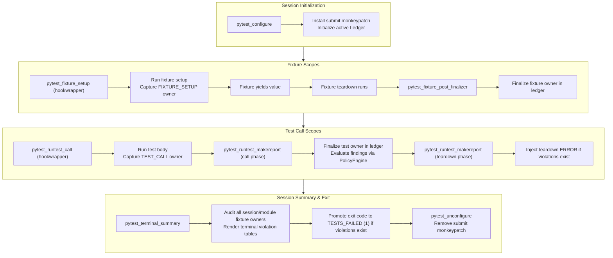

# Reporting & Pytest Integration Architecture

This document details how `pytest-state-guard` integrates into pytest's plugin lifecycle, intercepts test and fixture execution, generates findings from committed ledger evidence, and formats terminal reports.

---

## Pytest Hook Lifecycle Architecture

State Guard integrates cleanly into pytest using standard `pluggy` hooks, avoiding invasive changes to test runners:



---

## The Hook Implementations in Detail

In [src/pytest_state_guard/plugin.py](file:///C:/Users/Rud/Desktop/state-guard/src/pytest_state_guard/plugin.py):

### 1. `pytest_configure` and `pytest_unconfigure`
- **Configuration:** When pytest initializes, State Guard checks `config.getoption("state_guard", True)`. If enabled, it instantiates the session `Ledger`, registers it globally, and invokes `install_patch(ledger)`.
- **Cleanup:** During `pytest_unconfigure`, `remove_patch()` safely restores `ThreadPoolExecutor.submit` to its original function pointer.

### 2. `pytest_fixture_setup` & `pytest_fixture_post_finalizer`
- **Setup Wrapping:** `pytest_fixture_setup` is a `hookwrapper=True` hook. Before delegating to the fixture, it generates a unique fixture owner ID (`owner:fixture:<argname>:<uuid>`), commits `OWNER_CREATED` to the ledger, and sets the active `ContextVar`. Upon yield, it resets the `ContextVar`.
- **Teardown Finalization:** `pytest_fixture_post_finalizer` runs after all finalizers and post-yield code for that fixture conclude. It finalizes the owner in the ledger with sequence $S_F$.

### 3. `pytest_runtest_call` & `pytest_runtest_makereport`
- **Call Wrapping:** `pytest_runtest_call` wraps the test function invocation, activating an `OwnerType.TEST_CALL` owner.
- **Call Phase Makereport:** In `pytest_runtest_makereport` during `call` phase:
  1. The test owner is finalized in the ledger ($S_F$).
  2. The `PolicyEngine` captures an atomic point-in-time snapshot and evaluates the test owner and its tasks.
  3. Findings are cached in session state for teardown reporting.
- **Teardown Phase Makereport:** In `pytest_runtest_makereport` during `teardown` phase:
  - If the test has violations (`Severity.VIOLATION`), State Guard marks the teardown report as failed (`outcome="failed"`).
  - If the test already failed during teardown (e.g. an exception in a fixture finalizer), State Guard wraps the original error in a chained terminal representation (`ChainedTerminalRepr`) without overwriting the upstream traceback.

### 4. `pytest_terminal_summary`
- Evaluates any multi-test fixture owners (class, module, package, and session fixtures).
- Formats and prints the terminal summary tables (`VIOLATIONS DETECTED` and `UNCERTAIN FINDINGS`).
- **Exit Code Promotion:** If any owner produced findings with `Severity.VIOLATION`, State Guard sets the session exit code to `pytest.ExitCode.TESTS_FAILED` (`1`). Pre-existing failure exit codes (such as assertion failures) are preserved.

---

## Automatic Discovery & Deactivation

### Automatic Discovery via `pytest11`
State Guard requires zero configuration. It is registered via `pyproject.toml`:
```toml
[project.entry-points.pytest11]
state_guard = "pytest_state_guard.plugin"
```
Pytest's plugin manager auto-discovers and activates State Guard whenever the package is installed in the Python environment.

### Plugin Deactivation (`-p no:state_guard`)
State Guard supports pytest's standard plugin deactivation flag:
```bash
pytest -p no:state_guard
```
In `pytest_plugin_registered`, if the plugin is blocked, State Guard disables its hooks, leaves `ThreadPoolExecutor.submit` untouched, and introduces zero runtime overhead.

---

## Reporting Limitations

- **Single Process In-Memory Ledger:** Each pytest process maintains its own independent in-memory ledger. State Guard does not aggregate ledgers or correlate task lifecycles across separate processes (such as when running under `pytest-xdist` with process-based workers).
- **Passive Reporting Only:** State Guard formats and surfaces violations; it does not take remediation actions (such as terminating unjoined threads or resetting application state).

---

## Related Documentation

- [Ownership & Lifecycle Architecture](ownership-and-lifecycle.md): ContextVar propagation and owner scope boundaries.
- [Concurrency & Interception Model](concurrency-model.md): Detailed mechanics of submit patching and event sequencing.
