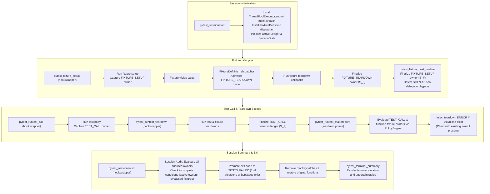

# Reporting & Pytest Integration Architecture

This document details how `pytest-state-guard` integrates into pytest's plugin lifecycle, intercepts test and fixture execution, generates findings from committed ledger evidence, and formats terminal reports.

---

## Pytest Hook Lifecycle Architecture

State Guard integrates cleanly into pytest using standard `pluggy` hooks, avoiding invasive changes to test runners:



---

## The Hook Implementations in Detail

In [src/pytest_state_guard/plugin.py](file:///C:/Users/Rud/Desktop/state-guard/src/pytest_state_guard/plugin.py):

### 1. `pytest_sessionstart` and `pytest_sessionfinish`
- **Session Initialization (`pytest_sessionstart`):** Instantiates `StateGuardSession` with a new synchronized `Ledger`, installs both the `ThreadPoolExecutor.submit` monkeypatch and the `FixtureDef.finish` static dispatcher, registers session state on `pytest.Session`, and transitions plugin lifecycle to `PluginLifecycle.ACTIVE`.
- **Session Teardown & Audit (`pytest_sessionfinish`):** A `hookwrapper=True` hook. In its post-yield phase:
  1. Audits all finalized owners across the session via `PolicyEngine.evaluate_all_finalized(ledger)`.
  2. Evaluates incomplete session conditions: checks for unfinalized active owners, unresolved post-finalizer sentinels, unfinalized teardown owners, and non-delegating plugin bypasses (`bypassed_fixtures`).
  3. Promotes session exit code (`session.exitstatus`) to `pytest.ExitCode.TESTS_FAILED` if any policy violations or incomplete instrumentation conditions were detected.
  4. Removes the submit monkeypatch and fixture finish patch, verifying that patches are completely removed.
  5. Transitions lifecycle to `PluginLifecycle.IDLE` (or `POISONED` if cleanup failed).

### 2. `pytest_fixture_setup`, `FixtureDef.finish`, & `pytest_fixture_post_finalizer`
- **Setup Wrapping (`pytest_fixture_setup`):** A `hookwrapper=True` hook. Generates a unique fixture setup owner ID (`owner:fixture:<argname>:<uuid>`), commits `OWNER_CREATED` to the ledger, and sets the active `ContextVar`. Upon yield or return, it resets the setup `ContextVar` token.
- **Teardown Dispatching (`_state_guard_fixture_finish`):** The static dispatcher intercepts `FixtureDef.finish`. If user teardown callbacks exist, it activates a dedicated `OwnerType.FIXTURE_TEARDOWN` owner, sets the active `ContextVar`, invokes the original finish implementation within `try ... finally`, and upon completion finalizes the teardown owner ($S_F$) and restores the prior context. Nested calls to `finish()` are tracked via `dispatch_depth` without duplicating owners.
- **Post-Finalizer Auditing (`pytest_fixture_post_finalizer`):** Finalizes the `FIXTURE_SETUP` owner in the ledger ($S_F$). Additionally, it verifies that the fixture's registered post-finalizer sentinel was consumed via the dispatcher. If a unique sentinel was consumed without the dispatcher being entered (and zero entry failures occurred), State Guard identifies a non-delegating plugin replacement (SCEN-10), records the degradation, registers the fixture in `state.bypassed_fixtures`, and ensures exit code promotion at session finish.

### 3. `pytest_runtest_call`, `pytest_runtest_teardown`, & `pytest_runtest_makereport`
- **Call Wrapping (`pytest_runtest_call`):** Wraps test function execution, activating an `OwnerType.TEST_CALL` owner and setting `_CURRENT_OWNER` via `ContextVar`. Resets the token upon completion.
- **Teardown Finalization (`pytest_runtest_teardown`):** A `hookwrapper=True` hook. In its `finally:` block (after the test function body, all fixture finalizers, and teardown logic conclude), it pops the test item owner from `active_test_owners` and finalizes it in the ledger, committing sequence $S_F$.
- **Teardown Phase Makereport (`pytest_runtest_makereport`):** A `hookwrapper=True` hook that acts strictly when `rep.when == "teardown"`.
  1. Queries all finalized owners attributed to `item.nodeid` (`TEST_CALL`, function-scoped `FIXTURE_SETUP`, and `FIXTURE_TEARDOWN`).
  2. Evaluates findings using `PolicyEngine.evaluate_owner()`.
  3. If violations exist (`Severity.VIOLATION`):
     - If the teardown passed (`rep.outcome == "passed"`), changes `rep.outcome = "failed"` and sets `rep.longrepr = StateGuardTerminalRepr(primary_owner, primary_findings)`.
     - If teardown already failed (e.g. an exception in a fixture finalizer), chains the violation diagnostic to the existing traceback using `ChainedTerminalRepr` without overwriting the original fixture failure evidence.

### 4. `pytest_terminal_summary`
- Retrieves cached findings and owners from the concluded session audit.
- Formats and renders the terminal audit sections:
  - `State Guard: Operational Lifecycle Failure` (if session was poisoned).
  - `State Guard: Incomplete Session Audit` (if finalization or instrumentation was bypassed).
  - `State Guard Audit: VIOLATIONS DETECTED` (for any owner with `Severity.VIOLATION`).
  - `State Guard Audit: UNCERTAIN LIFECYCLE INVARIANTS` (for advisory `Severity.UNCERTAIN` findings).

---

## Automatic Discovery & Deactivation

### Automatic Discovery via `pytest11`
State Guard requires zero configuration. It is registered via `pyproject.toml`:
```toml
[project.entry-points.pytest11]
state_guard = "pytest_state_guard.plugin"
```
Pytest's plugin manager auto-discovers and activates State Guard whenever the package is installed in the Python environment.

### Plugin Deactivation (`-p no:state_guard`)
State Guard supports pytest's standard plugin deactivation flag:
```bash
pytest -p no:state_guard
```
In `pytest_plugin_registered`, if the plugin is blocked, State Guard disables its hooks, leaves `ThreadPoolExecutor.submit` untouched, and introduces zero runtime overhead.

---

## Reporting Limitations

- **Single Process In-Memory Ledger:** Each pytest process maintains its own independent in-memory ledger. State Guard does not aggregate ledgers or correlate task lifecycles across separate processes (such as when running under `pytest-xdist` with process-based workers).
- **Passive Reporting Only:** State Guard formats and surfaces violations; it does not take remediation actions (such as terminating unjoined threads or resetting application state).

---

## Related Documentation

- [Ownership & Lifecycle Architecture](ownership-and-lifecycle.md): ContextVar propagation and owner scope boundaries.
- [Concurrency & Interception Model](concurrency-model.md): Detailed mechanics of submit patching and event sequencing.
