# Test & Fixture Usage Guide

This guide describes how `pytest-state-guard` models task ownership across pytest tests and fixtures, demonstrates safe concurrent testing patterns, and explains how to structure your tests to avoid leaking background tasks.

---

## The Submitter Ownership Model

In concurrent systems, an executor is an execution engine—often a shared, long-lived resource configured across multiple fixtures or tests. The entity responsible for a task's existence and lifecycle boundary is the **submitter**, not the executor.

State Guard establishes ownership through three distinct scopes:

```mermaid
flowchart TD
    subgraph TestLifecycle["Test Call Lifecycle"]
        TC_Start["pytest_runtest_call begins<br>OwnerContext(TEST_CALL) active"] --> TC_Body["Test function executes<br>executor.submit() captures TEST_CALL"]
        TC_Body --> TC_End["Test function returns/raises"]
        TC_End --> TC_Teardown["pytest_runtest_teardown hook<br>Runs test & fixture teardowns"]
        TC_Teardown --> TC_Finalize["Owner finalized: S_F committed"]
        TC_Finalize --> TC_Report["pytest_runtest_makereport (teardown)<br>Surfaces ERRORS if violations exist"]
    end

    subgraph FixtureLifecycle["Fixture Lifecycle"]
        FX_Start["pytest_fixture_setup begins<br>OwnerContext(FIXTURE_SETUP) active"] --> FX_Body["Fixture setup executes<br>executor.submit() captures FIXTURE_SETUP"]
        FX_Body --> FX_Yield["Fixture yields value to test<br>Setup OwnerContext reset"]
        FX_Yield --> FX_Wait["Test execution occurs..."]
        FX_Wait --> FX_Teardown["FixtureDef.finish dispatcher begins<br>OwnerContext(FIXTURE_TEARDOWN) active"]
        FX_Teardown --> FX_TearBody["Fixture teardown executes<br>executor.submit() captures FIXTURE_TEARDOWN"]
        FX_TearBody --> FX_TearFin["Teardown owner finalized: S_F committed"]
        FX_TearFin --> FX_Finalize["pytest_fixture_post_finalizer<br>Setup owner finalized: S_F committed"]
    end
```



### 1. Test Call Ownership (`TEST_CALL`)
- **Boundary:** Begins when `pytest_runtest_call` invokes the test function and ends when the test function returns or raises.
- **Attribution:** Any callable submitted to a `ThreadPoolExecutor` while the test function is running is bound to that test item's `TEST_CALL` owner.
- **Finalization:** The owner is finalized in `pytest_runtest_teardown` after test execution and associated fixture finalizers conclude. State Guard audits all tasks submitted by the test function against this finalization boundary.

### 2. Fixture Setup Ownership (`FIXTURE_SETUP`)
- **Boundary:** Begins when `pytest_fixture_setup` begins executing the fixture and ends when setup returns or yields.
- **Attribution:** Tasks submitted during fixture setup are bound to that fixture's `FIXTURE_SETUP` owner across all fixture scopes (`function`, `class`, `module`, `package`, `session`).
- **Finalization:** Finalized in `pytest_fixture_post_finalizer` after that fixture's teardown logic has completed.

### 3. Fixture Teardown Ownership (`FIXTURE_TEARDOWN`)
- **Distinct Ownership Boundary:** Fixture teardown and finalizers do **not** run under the completed `FIXTURE_SETUP` owner. Instead, State Guard intercepts `FixtureDef.finish` using a dynamic dispatcher, activating a dedicated `OwnerType.FIXTURE_TEARDOWN` owner for the duration of user finalizer and post-yield execution.
- **Teardown Task Auditing:** Tasks submitted to an executor during fixture teardown are bound to that fixture's teardown owner. The submitting teardown block must join or wait for all submitted tasks before concluding; any task left executing or queued past the teardown finalization boundary is flagged as a concurrency violation.
- **Instrumentation Bypass Safeguards:** If a third-party plugin replaces `FixtureDef.finish` with a non-delegating wrapper, State Guard cannot instrument teardown submissions directly. Instead, State Guard detects this bypass during `pytest_fixture_post_finalizer` (SCEN-10), records an operational degradation, and promotes the session exit code to `TESTS_FAILED` during session audit to prevent unmonitored execution from passing silently.

---

## Safe Concurrency Patterns in Tests

### Pattern 1: Test-Scoped Executor with Context Manager

The simplest and safest pattern for test functions that need a thread pool is using `ThreadPoolExecutor` as a context manager:

```python
from concurrent.futures import ThreadPoolExecutor

def test_isolated_worker():
    with ThreadPoolExecutor(max_workers=2) as executor:
        future = executor.submit(pow, 2, 8)
        assert future.result(timeout=1.0) == 256
    # Context manager exit calls executor.shutdown(wait=True),
    # joining worker threads before the test boundary finalizes.
```

When the `with` block exits, `executor.shutdown(wait=True)` ensures all worker threads finish executing submitted callables before test finalization occurs.

### Pattern 2: Explicit Future Synchronization

If an executor cannot be shut down immediately (for example, when using a shared fixture executor), synchronize on the `Future` objects explicitly:

```python
from concurrent.futures import ThreadPoolExecutor, as_completed

def test_multiple_workers(shared_executor: ThreadPoolExecutor):
    futures = [shared_executor.submit(abs, x) for x in [-1, -2, -3]]
    
    # Explicitly wait for all submitted futures within the test body
    results = [f.result(timeout=2.0) for f in as_completed(futures)]
    assert sum(results) == 6
```

### Pattern 3: Shared Fixture-Scoped Executor

When providing a thread pool via a pytest fixture, manage the executor's lifetime across the entire fixture scope:

```python
import pytest
from concurrent.futures import ThreadPoolExecutor

@pytest.fixture(scope="module")
def shared_executor():
    executor = ThreadPoolExecutor(max_workers=4)
    yield executor
    # Teardown: shut down and join all workers before module teardown ends
    executor.shutdown(wait=True)
```

In tests consuming `shared_executor`:
1. Work submitted during a test function is attributed to that test's `TEST_CALL` owner.
2. The test function is responsible for joining or awaiting any work it submitted before returning.
3. The fixture teardown joins the executor itself.

---

## Synchronization Strategies: Events vs. Sleeps

When testing concurrent code, do not rely on arbitrary sleeps (`time.sleep()`) as a synchronization mechanism. Operating system thread scheduling is non-deterministic; arbitrary sleeps lead to flaky tests in CI and do not guarantee task completion before teardown.

Instead, use explicit synchronization primitives from the standard library:

| Primitive | Recommended Use Case |
| :--- | :--- |
| `threading.Event` | Signaling between test thread and worker thread (e.g., worker startup or cancellation). |
| `concurrent.futures.Future.result(timeout=...)` | Waiting for a worker callable to finish and retrieving its return value. |
| `concurrent.futures.wait(futures, timeout=...)` | Awaiting a batch of submitted futures with a bounded timeout. |
| `threading.Barrier` | Coordinating simultaneous startup across multiple concurrent workers. |

```python
import threading
from concurrent.futures import ThreadPoolExecutor

def test_event_synchronized_worker():
    ready = threading.Event()

    def worker_action():
        ready.set()
        return "completed"

    with ThreadPoolExecutor(max_workers=1) as executor:
        future = executor.submit(worker_action)
        assert ready.wait(timeout=2.0), "Worker callable failed to start"
        assert future.result(timeout=2.0) == "completed"
```

---

## Interpreting Teardown Diagnostics

State Guard enforces clean separation between test assertions and teardown lifecycle violations:

### 1. Test Assertions Pass, but Background Work Leaked
If all `assert` statements in your test function pass, but a task was left executing or unjoined, State Guard injects an error during test teardown:

```text
test_demo.py::test_leaky_call PASSED                                     [100%]
test_demo.py::test_leaky_call ERROR                                      [100%]

=================================== ERRORS ====================================
____________________ ERROR at teardown of test_leaky_call _____________________

- State Guard Teardown Violation: TEST_CALL [test_demo.py::test_leaky_call] -
Owner ID: owner:test:test_demo.py::test_leaky_call:<uuid>
Owner Finalized Sequence: 7 (created at seq 2)

  * Finding: finding:owner:test:test_demo.py::test_leaky_call:<uuid>:task:<task_uuid>
    Classification: CALLABLE_NOT_EXITED
    Task ID:        task:<task_uuid>
    Evidence:       Task 'task:<task_uuid>' callable began execution at seq 4 before finalization, but has not committed an exit event.
    Sequences:      3, 4, 7
```

### 2. Test Assertions Failed AND Background Work Leaked
If your test failed an assertion, State Guard preserves the failure and displays both:
- Under `=== FAILURES ===`: The original assertion failure with its complete Python traceback.
- Under `=== ERRORS ===`: The State Guard teardown error reporting the leaking task.

Original test failure evidence is never overwritten or hidden.

---

## Deactivating State Guard

To temporarily deactivate State Guard for a specific test run without uninstalling it from the environment:

```bash
pytest -p no:state_guard
```

When deactivated, State Guard registers zero hooks, leaves `ThreadPoolExecutor.submit` unpatched, and introduces zero runtime overhead.

---

## Related Documentation

- [Classifications & Severities Reference](classifications.md): Learn the exact meaning of all ten frozen diagnostic classifications.
- [Troubleshooting Guide](troubleshooting.md): Step-by-step diagnostic workflows for fixing concurrency leaks.
